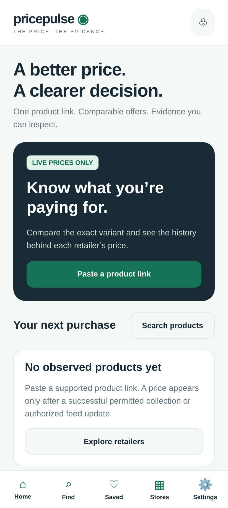
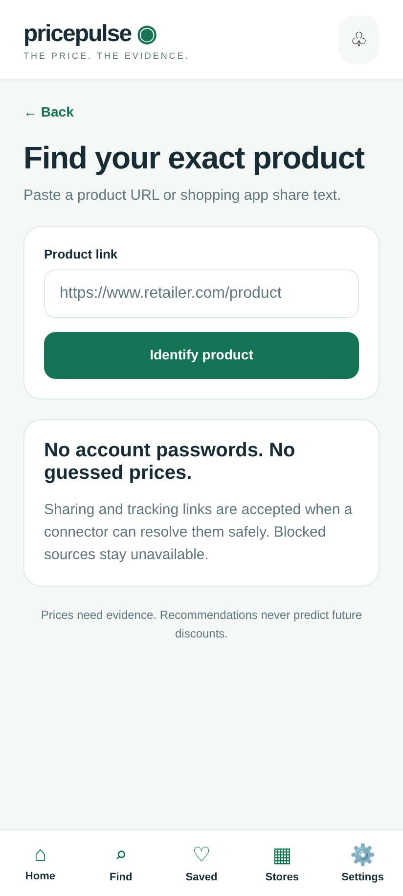
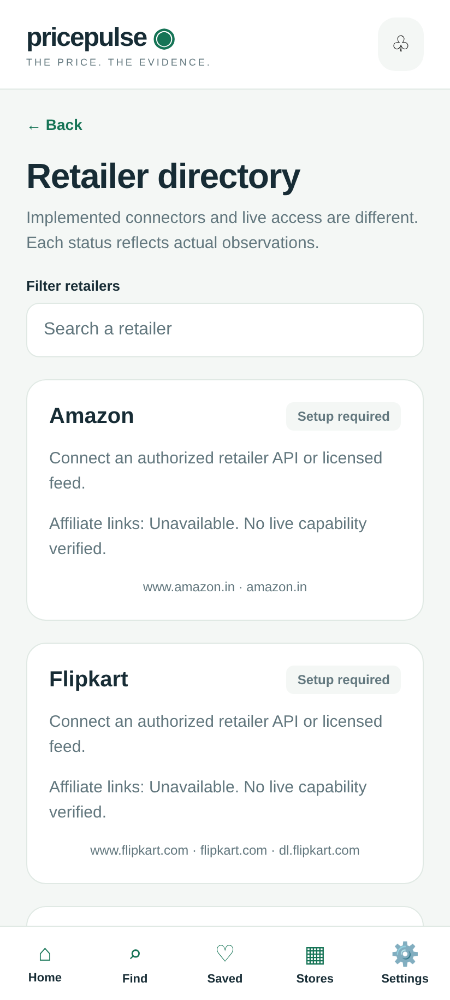

# Preview PricePulse on GitHub

The new Expo app is live-only. Public frontend hosting does not run the FastAPI
collector service or provide retailer credentials. Missing live prices remain unavailable.

## View the interface now

These screenshots were captured from the actual running app in a phone-sized browser.
They contain no fabricated prices.





## Interactive GitHub Pages preview

The Pages artifact is exported with the repository subpath and includes all main screen
entry points, a 404 fallback for dynamic product routes, and `.nojekyll` for Expo assets.
It is the same React Native web app; no demo dataset is added. The retailer directory
can display declared integrations with Setup required even before a backend is connected.

The repository owner can enable **Settings → Pages → Build and deployment → Source →
GitHub Actions**, then run **Actions → Publish mobile web preview → Run workflow**.
The workflow's deployment output provides the actual website URL on success.
The workflow also runs automatically after subsequent mobile changes on main.

For the already-exported `gh-pages` branch, the alternate setup is **Deploy from a branch →
gh-pages → / (root) → Save**. Use one publication source at a time.

To connect actual prices, set the non-secret repository variable
`PRICEPULSE_PREVIEW_API_URL` to the deployed HTTPS FastAPI backend and allow the Pages
origin in backend `PULSE_CORS_ORIGINS`. Never use a provider key as a public repository
variable or Expo public environment variable. GitHub Pages cannot host Python or PostgreSQL.

Local reproducible build:

```sh
cd mobile
npm ci
npm run build:pages
```

The GitHub API and Pages hostname were initially denied by this cloud's network policy.
A prepared artifact or Git push does not establish successful Pages deployment. Check
the deployment status before treating the website as published.
